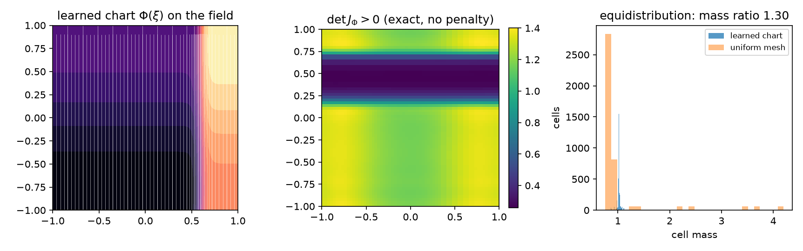

# D'Agnese Chart Operator (DAO)

[](https://doi.org/10.5281/zenodo.22814077)
[](https://github.com/GiovanniDAgnese-paper/DIF-FNO/actions/workflows/ci.yml)
[](tests/)
[](LICENSE)
[](https://pytorch.org/)
[](https://www.python.org/)
[](docs/THEORY.md)

A Fourier neural operator evaluated on a **certified, adaptively learned chart**.

Deforming the grid of a neural operator is an old idea with a fatal flaw: a
learned deformation has no reason to be a diffeomorphism, and a folded grid
silently destroys the representation — usually while the training loss looks
fine. Previous work *penalises* folding. This repository removes it.

| object | what it is | guarantee |
|---|---|---|
| **D'Agnese chart** (`DagneseTriangularChart`) | a constructive diffeomorphism of the reference square, `Φ(ξ) = (g(ξ₁), h(ξ₁,ξ₂))`, built from strictly positive increments | injective, `det J > 0` **as a product of positive factors**, closed-form inverse at arbitrary points, `det J ≥ ε²` for every parameter value |
| **D'Agnese Chart Operator** (`"chart"`) | an FNO evaluated on the chart, `u = P⁻¹ F_θ(Φ, P a)` | **exactly the FNO baseline at initialisation** (3e-8) — a strict super-set of it |
| **D'Agnese Equidistribution Loss** (`DagneseEquidistributionLoss`) | normalised variance of the monitor mass per cell | zero **iff** the mesh equidistributes; scale free; `max_C M_C/M̄ ≤ 1 + √(N_c L)` |

No penalty, no constraint projection, no trust region: the failure mode is
outside the model class.

```python
import torch
from dagnese_fno import DagneseChartOperator

coords = torch.stack(torch.meshgrid(torch.linspace(-1, 1, 64),
                                    torch.linspace(-1, 1, 64), indexing="ij"), -1)
a = torch.rand(1, 64, 64)

model = DagneseChartOperator()                 # at init == FNO, bit for bit
u, aux = model(coords, a)                      # u: (1,64,64); aux carries the chart
aux["phi"].shape, aux["det"].min()             # (1,64,64,2), 1.0
aux["det_lb"]                                  # certified lower bound, > 0 for all θ
```

Train it:

```bash
python scripts/train.py --domain star --model chart --lambda-eq 10 --epochs 60
```

---

## 1. Why the chart, in one figure

```
   a(ξ) ──pullback──► ã(ξ) = a(Φ(ξ))
                          │
   Φ certified            ▼
   (det J > 0)      FNO backbone  ──►  ũ(ξ)
                          │
                    pushforward P⁻¹ (closed-form inverse)
                          ▼
                     u(x) = ũ(Φ⁻¹(x))
```

* **Baseline** (`fno`): the backbone sees `(ξ₁, ξ₂, a)`.
* **DAO** (`chart`): the backbone sees `(Φ₁, Φ₂, a∘Φ)` and the output is
  transported back. At `t = 0`, `Φ = Id` and the two are the *same function*.
* **DAO + equidistribution** (`chart-eq`): the chart additionally minimises the
  D'Agnese Equidistribution Loss, i.e. it concentrates cells where the field has
  a layer.

The chart adds **1 602 parameters** on top of 334 737 (+0.5%) and costs ×2.8
wall clock at 64² on CPU (47 → 131 ms per training step, batch 10, two threads,
`python scripts/bench_timing.py`): two bilinear samplings and the knot
construction. We report the cost everywhere.

---

## 2. What is proved, and what is measured

| statement | status | where |
|---|---|---|
| the chart is injective (globally, not just locally) | **theorem** | P5.i |
| `det J > 0` on every cell, computed as a product (no cancellation) | **theorem** | P5.ii |
| closed-form inverse, on a grid and at arbitrary points | **theorem** | P5.iii |
| `det J ≥ (2ε/(KΔξ))² = ε²` for every θ, N and deformation size | **theorem** | P5.iv |
| the chart is the identity at initialisation | **theorem** | P5.v |
| the class is closed under composition | **theorem** | P5.vi |
| pullback/pushforward round trip is `O(h²)` | **theorem** | P6 |
| the equidistribution loss vanishes iff equidistributed, is scale free, bounds the worst cell | **theorem** | P7.i–iii |
| equidistribution minimises a certified bound on the representation error | **theorem** | P7.iv |
| the operator is exactly the baseline at initialisation | **measured** (3e-8) | §4 |
| equidistribution improves the *representation* of feature-dominated fields | **measured** (2–4×) | §3 |
| the chart improves the PDE accuracy | **measured**: −8.6 % L2, −9.7 % H1 (p = 4e-4 / <1e-4), 16/18 runs, 6/6 geometries | §4 |
| the equidistribution loss improves on the chart alone | **measured**: −0.0073 L2, 17/18 runs (p = 4e-4), identical budget | §4 |
| the certificate is tight | **no** — it is a worst case over θ | P5 scope note |

Full proofs: [`docs/THEORY.md`](docs/THEORY.md) (Part II). Manuscript:
[`paper/`](paper/).

---

## 3. Deterministic verification (no training, no seeds)

```bash
python scripts/run_chart_study.py            # ~40 s, writes results/study/ + figures/study/
```

**P5 — the guarantee cannot be lost.** Chart parameters scaled from 0 (identity)
to 10³ (area compressed by six orders of magnitude), three random inits each,
`N = 32`:

| parameter scale | min det J | folded cells | certified bound | parameter-free floor |
|---|---|---|---|---|
| 0 (identity) | 1.000 | 0.00 % | 1.000 | 1e-6 |
| 0.1 | 0.886 | 0.00 % | 0.880 | 1e-6 |
| 1 | 1.41e-6 | 0.00 % | 1.22e-6 | 1e-6 |
| 3 | 9.98e-7 | 0.00 % | 9.98e-7 | 1e-6 |
| 10 | 9.97e-7 | 0.00 % | 9.97e-7 | 1e-6 |
| 30 | 9.97e-7 | 0.00 % | 9.97e-7 | 1e-6 |
| 10² | 9.99e-7 | 0.00 % | 9.99e-7 | 1e-6 |
| 10³ | 9.99e-7 | 0.00 % | 9.99e-7 | 1e-6 |

**P6 — the round trip is second order.** Smooth field, one random chart
(scale 0.4): max error 5.60e-2 → 1.43e-2 → 3.46e-3 → 9.04e-4 for
`N = 32, 64, 128, 256`; observed order **1.97 (rms) / 1.99 (max)**; the exact
inverse holds to 1e-6 at every resolution.

**P7 — the loss learns the mesh.** A one-layer chart trained by Adam on the
equidistribution loss alone, from the identity, 600 steps, `N = 64`, on fields it
never sees:

| field | loss (init → final) | cell-mass ratio | representation error, uniform | chart | gain |
|---|---|---|---|---|---|
| boundary layer | 0.43 → 9.0e-4 | 1.30 | 4.06e-2 | 9.9e-3 | **4.1×** |
| ridge | 0.18 → 1.2e-3 | 1.49 | 1.34e-2 | 6.7e-3 | **2.0×** |
| smooth | 0.029 → 2.2e-3 | 1.81 | 1.71e-3 | 3.2e-3 | 0.54× |

The last row is a **negative result** and it is in the paper on purpose:
equidistribution minimises the worst *mass*, which is only an upper bound on the
representation error, and for a field without structure the bound is vacuous.
That is why the loss is an auxiliary term with a weight, and why the identity is
in the class.



---

## 4. PDE benchmark (paired seeds)

Protocol: Darcy flow on six geometries (star, L-shape, annulus, NACA0012, a
cracked plate and a doubly perforated plate), `N = 64`, 100 samples, 80/20 split,
40 epochs, Adam(1e-3), batch 10, three seeds, identical backbone
(`width=24`, `modes=(12,12)`, 2 layers, 334 737 parameters). Paired difference
against the FNO at the *same seed*; negative = better.

```bash
python scripts/generate_data.py --domains star lshape annulus naca0012 slit double_hole --n 64 --samples 100
python scripts/run_benchmark.py --domains star lshape annulus naca0012 slit double_hole \
       --variants fno chart-eq chart-fixed --seeds 0 1 2 \
       --epochs 40 --eval-every 5 --out results/v2
python scripts/make_paper_table.py      # tables + figure
python scripts/report_stats.py          # every statistic quoted here
```

| Domain | fno L2 | chart-fixed L2 | chart-eq L2 | Δchart-fixed L2 | Δchart-eq L2 |
|---|---|---|---|---|---|
| star | 0.1636 | 0.1624 | 0.1597 | -0.0012 ± 0.0119 | -0.0039 ± 0.0124 |
| lshape | 0.2045 | 0.1995 | 0.1898 | -0.0050 ± 0.0110 | -0.0147 ± 0.0080 |
| annulus | 0.1835 | 0.1729 | 0.1713 | -0.0106 ± 0.0179 | -0.0121 ± 0.0178 |
| naca0012 | 0.1975 | 0.1872 | 0.1843 | -0.0103 ± 0.0145 | -0.0132 ± 0.0146 |
| slit | 0.2289 | 0.2095 | 0.1975 | -0.0194 ± 0.0191 | -0.0314 ± 0.0175 |
| double_hole | 0.1986 | 0.1801 | 0.1649 | -0.0185 ± 0.0038 | -0.0337 ± 0.0052 |

*Ablation, identical architecture and budget:* `chart-eq` minus `chart-fixed` = **-0.0073 ± 0.0072** over n = 18 (t = -4.34, p = 0.0004, 17/18 runs negative).

**What it shows.** The chart operator is *more* accurate on all six geometries.
Pooled over the eighteen paired runs: `dL2 = -0.0182` (**-8.6 %** in the mean of
per-run ratios, t = -4.36, p = 4e-4, Wilcoxon 3e-4, 16/18 runs improved, 6/6
geometry means negative -> domain-level sign test p = 0.016) and
`dH1 = -0.0413` (**-9.7 %**, t = -6.18, p < 1e-4).

**The ablation that matters.** The chart *alone* helps too (`-0.0108`, p = 0.010),
so "learning a deformation" is not nothing. But with the **identical
architecture and budget**, adding the D'Agnese Equidistribution Loss improves
**17 of 18 runs** by a further `-0.0073` (p = 4e-4) in L2 and **18 of 18** in
H1. The gain is not a re-parameterisation; it is the loss.

**What it does not show.** The pooled test treats eighteen runs nested in six
geometries as independent -- that is why the domain-level sign test is printed
too. The protocol is small (40 epochs, 100 samples, one backbone, one
resolution, one PDE) and two runs are *worse* than their baseline.
Admissibility, on the other hand, is not a statistical claim: every run has
**0.00 % folded cells**, `min det J >= 0.033`, a certified bound `>= 0.020` and
an inverse error `<= 1.3e-6`, while the chart compresses cells by up to 30x
where the monitor asks for it.

---

## 5. What the numbers do *not* say

* Nothing here *bounds* the PDE error. The 9 % gain in §4 is a measurement, not
  a consequence of the theory.
* `ε²` is a worst case over the whole parameter space: a trained chart has
  `min det J = 0.03–0.9` while the certificate reports `1e-6`. Both are reported.
* Equidistribution is not universally beneficial: it hurts on a field without
  structure (§3, third row) and helps on the PDE benchmark (§4).
* The chart costs ×2.8 wall clock at 64² on CPU.
* The benchmark is *not* comparable with the published v1 table: the data
  pipeline was rewritten (see §8), so `results/repro` and `results/v2` must not
  be mixed.

---

## 6. Install

```bash
git clone https://github.com/GiovanniDAgnese-paper/DIF-FNO.git && cd DIF-FNO
python -m venv .venv && source .venv/bin/activate
pip install -e ".[dev]"
```

CPU-only PyTorch: `pip install torch --index-url https://download.pytorch.org/whl/cpu`.

## 7. Thirty-second tour

```python
import torch
from dagnese_fno import (DagneseTriangularChart, DagneseEquidistributionLoss,
                         pullback, pushforward, DagneseChartOperator)

t = torch.linspace(-1, 1, 64)
coords = torch.stack(torch.meshgrid(t, t, indexing="ij"), -1)

# 1. the chart itself: injective, det J > 0, exactly invertible
chart = DagneseTriangularChart(hidden=32, n_fourier=3)      # == identity at init
phi, det = chart(coords)
chart.inverse_consistency_error(coords)                     # ~1e-7
chart.certified_det_lower_bound(coords)                     # positive for every weight
chart.inverse_at(phi.reshape(-1, 2)[None])                  # exact, arbitrary points

# 2. transport
f = torch.sin(3 * coords[..., 0])[None]
back = pushforward(pullback(f, phi[None], det[None]), chart.inverse(coords[None]))
(back - f).abs().max()                                      # O(h^2)

# 3. the equidistribution loss: zero iff the mesh equidistributes
loss = DagneseEquidistributionLoss()
monitor = loss.monitor(f, spacing=2 / 63)
loss(monitor, det)                                          # scale free, >= 0

# 4. the operator (exactly the FNO at initialisation)
model = DagneseChartOperator(width=24, modes1=12, modes2=12)
u, aux = model(coords, torch.rand(1, 64, 64))
aux["det_lb"]                                               # certified, > 0
```

End-to-end example: [`examples/quickstart.py`](examples/quickstart.py).

---

## 8. v1 line (kept as an ablation)

The repository grew out of **DIF-FNO** (v1.x): an FNO on a *penalised*
deformation, with the D'Agnese Topological Barrier Loss and a
Lipschitz-certified variant. It is still here — it is the ablation that shows why
a penalty is not a guarantee.

| configuration | folding | min det J | certified bound |
|---|---|---|---|
| `dif-nobar` (no barrier) | **12–22 %** | −19 … −34 | 0 (none) |
| `dif-barrier` | 0.00 % | +0.50 … +0.65 | **0** (none) |
| `dif-certified` (Lipschitz cap) | 0.00 % | +1.06 | 0.42 … 0.52 |
| `chart-fixed` / `chart-eq` (v2) | **0.00 % (structural)** | > 0 | **ε² > 0 for every θ** |

```python
from dagnese_fno import DIFFNO2d, DAgneseBarrierLoss    # the v1 objects
model = DIFFNO2d()
u, xi = model(coords[None], a)
DAgneseBarrierLoss(tau=0.05)(jacobian_det(xi, spacing=2 / 63))
```

The v1 numbers are in [`results/repro/`](results/repro) and were produced with
the original data pipeline; see [`CHANGELOG.md`](CHANGELOG.md) for the four
numerical conventions that changed in 1.1.0 (most importantly: `det J` is a
derivative, so a raw forward difference returns `h² det J` — at `n = 64` the
identity reports `1.0e-3` instead of `1`).

## 9. Repository map

```
src/dagnese_fno/
├── geometry/
│   ├── monotone.py         DagneseTriangularChart  (P5) + exact inverse, inverse_at
│   ├── transport.py        pullback / pushforward / sample_field (P6)
│   └── jacobian.py         spacing-aware Jacobian calculus, v1 certificate (P3, P4)
├── losses/
│   ├── equidistribution.py DagneseEquidistributionLoss (P7)
│   ├── barrier.py          D'Agnese softplus barrier (P2, v1)
│   └── combined.py         MSE + alpha*H1 + lambda*barrier + lambda_eq
├── models/
│   ├── chart_operator.py   DagneseChartOperator  (the operator)
│   ├── spectral.py         SpectralConv2d
│   ├── fno.py              FNO2d backbone
│   ├── diffeo.py           v1 deformation (zero-init, Lipschitz cap)
│   └── dif_fno.py          v1 DIFFNO2d
├── data/                   Darcy generator, masks, solver, datasets
├── training/trainer.py     the loop and every reported metric
├── metrics/errors.py       relative L2 / H1 / Hinf, masked
└── cli/                    dif-fno-train, dif-fno-generate-data
scripts/   generate_data.py · train.py · run_benchmark.py · run_chart_study.py
           · make_paper_table.py · report_stats.py · bench_timing.py · make_figures.py
tests/     178 tests: every proposition, the solver, the models, end-to-end
docs/      THEORY.md (P1–P8) · DESIGN_NOTES.md (decisions, costs, open questions)
           · REVIEW.md (the adversarial self-review: every defect found and fixed)
           · ANNOUNCEMENT.md (ready-to-publish abstract, thread, venue notes)
paper/     dagnese-chart-operator.tex + references.bib + tables/
results/   study/ (deterministic) · v2/ (paired benchmark) · repro/ (v1, historical)
figures/   study/ · paper/ · repro/
```

## 10. Citation

```bibtex
@software{dagnese_chart_operator_2026,
  author    = {D'Agnese, Giovanni},
  title     = {The D'Agnese Chart Operator: Certified, Exactly Invertible,
               Adaptively Learned Charts for Neural Operators},
  version   = {1.2.0},
  year      = {2026},
  doi       = {10.5281/zenodo.22814077},
  url       = {https://github.com/GiovanniDAgnese-paper/DIF-FNO}
}
```

## 11. License

MIT — see [`LICENSE`](LICENSE).
